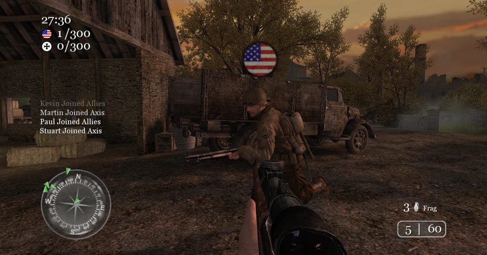
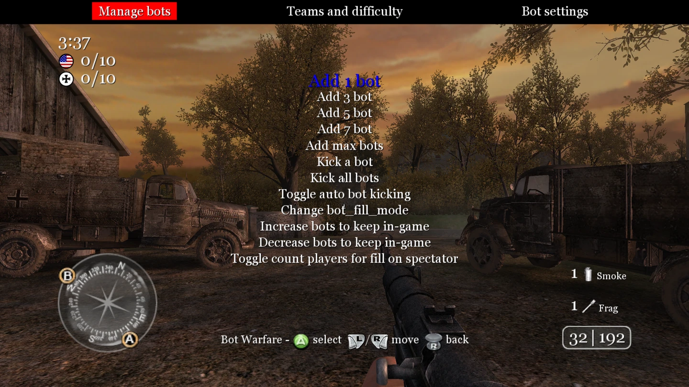

import { Badge, LinkButton } from "@astrojs/starlight/components";



Bot Warfare adds AI opponents to Call of Duty 2 multiplayer. You’ll need the USA / Europe release with **TU3** and [CoD Xe](/setup/).

## Download and install

<LinkButton
  href="https://github.com/codxenon/iw2-bot-warfare-xenon/releases/download/v2.3.0-xenon/iw2bw-2.3.0-xenon.zip"
  icon="download"
>
  Download Bot Warfare ZIP
</LinkButton>

1. Extract the ZIP into your [Call of Duty 2 content folder](/setup/#game-content-folders). The mod should be in `mods/mp_bots/`.
2. Create `codxe.json` beside the `mods/` folder with the contents below. If you already have a `codxe.json`, set `active_mod` to `mp_bots` in that file.

   ```json
   {
     "active_mod": "mp_bots"
   }
   ```

## Play with bots

1. Launch Call of Duty 2 multiplayer and host a match.
2. With the default controls, hold <Badge text="X" /> and click the right stick (<kbd><Badge text="RS" /></kbd>) to open the Bot Warfare menu.
3. Use <Badge text="LT" /> and <Badge text="RT" /> to move through the menu. Press <Badge text="A" /> to select or <kbd><Badge text="RS" /></kbd> to go back or close the menu.
4. Open **Manage bots** to add bots. Use **Teams and difficulty** to adjust how they play.



To rename bots, edit `mods/mp_bots/scriptdata/botnames.txt` in your Call of Duty 2 content folder. Put one name on each line.

## Bot waypoints

Bot routes can be rough in places on the base maps. The Xbox 360 DLC maps have no bot waypoint data because those maps were never released on PC.

If you know how to make waypoints, improvements to existing routes and new routes for DLC maps are welcome. [Contribute to the open-source Call of Duty 2 port on GitHub](https://github.com/codxenon/iw2-bot-warfare-xenon).

Original mod by [INeedGames](https://github.com/ineedbots/iw2_bot_warfare).
