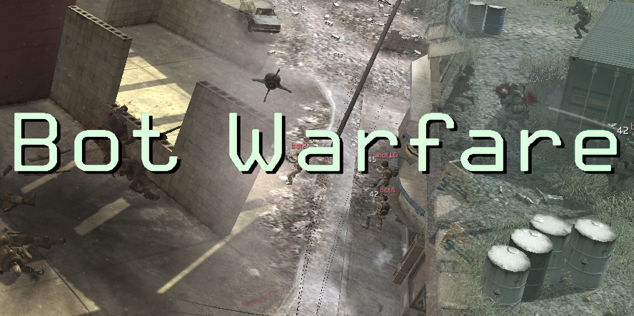
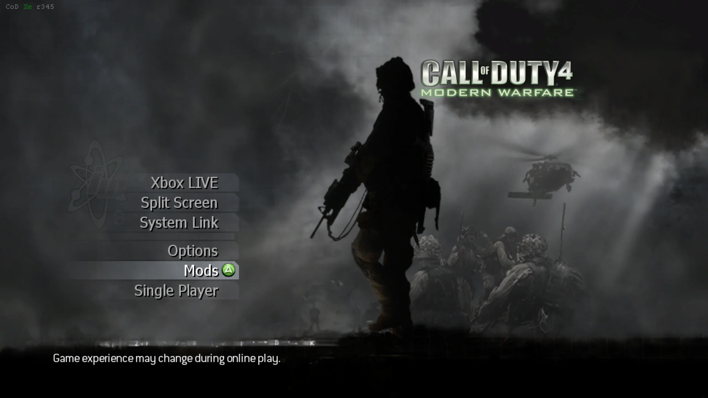
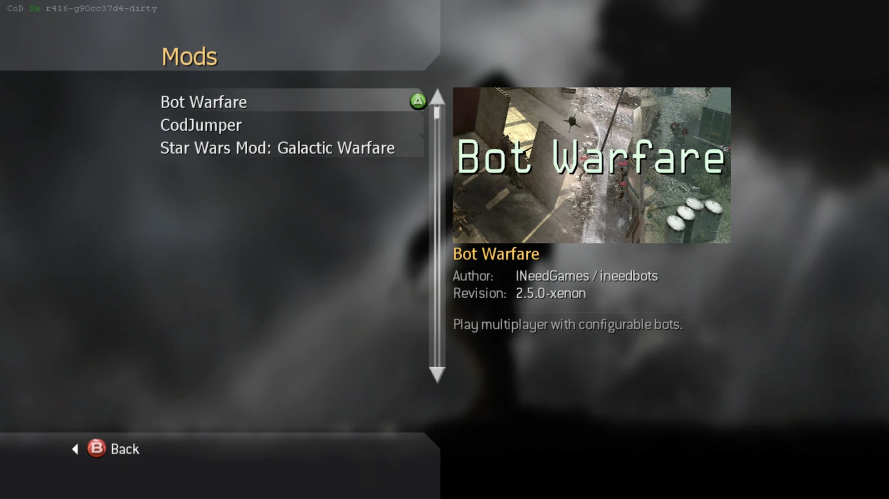
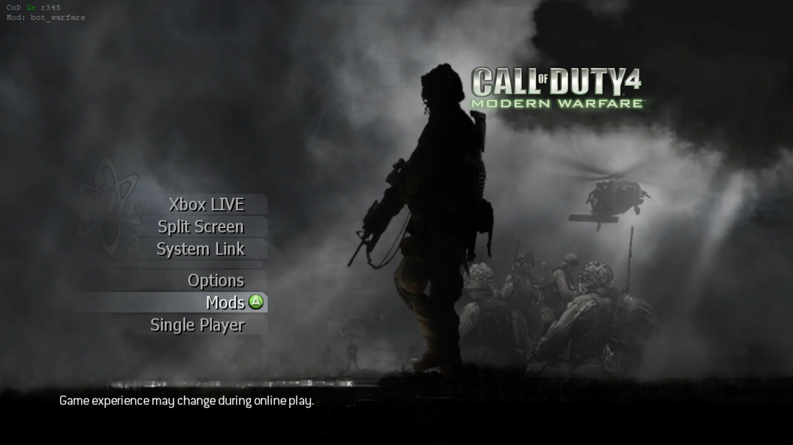
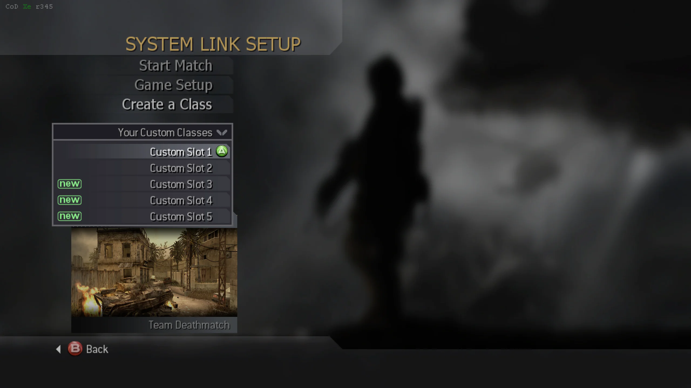
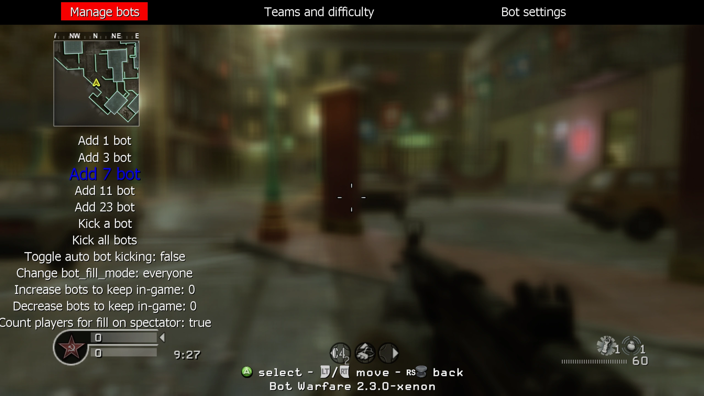

import {
  Aside,
  Badge,
  LinkButton,
  LinkCard,
} from "@astrojs/starlight/components";

Bot Warfare adds playable AI bots to Call of Duty 4 multiplayer.

The original mod was created by [INeedGames](https://ineedbots.github.io). This port runs through the CoD Xe plugin.

Use a USA / Europe copy of Call of Duty 4 with **TU4** and [CoD Xe](/setup/).

## Install Bot Warfare

Download the latest Bot Warfare release:

<LinkButton
  href="https://github.com/codxenon/iw3-bot-warfare-xenon/releases/download/v2.5.0-xenon/iw3bw-2.5.0-xenon.zip"
  download
  icon="download"
>
  Download **Bot Warfare**
</LinkButton>

Open `_codxe/mods/` inside the ZIP. Copy the complete `bot_warfare` folder into `mods/` in your [Call of Duty 4 content folder](/setup/#game-content-folders).

## Select Bot Warfare

1. Start Call of Duty 4 and select **Mods** from the main menu.

2. Select **Bot Warfare**. Packages without a display title appear as `bot_warfare`.

After you select it, the game returns to the main menu. The top left shows
`Mod: bot_warfare` when Bot Warfare is active.

## Using Bot Warfare

Start a System Link or private match.

### Offline Create a Class

CoD Xe enables **Create a Class** in **System Link** and **Split Screen**, so
you can customise your loadouts completely offline.

### In-Game Menu

In a System Link or private match, press <Badge text="X" /> + <Badge text="RS" /> to open
the Bot Warfare menu.

### Bot Limits and Performance

Use the **Bot awareness quality** setting in the Bot Warfare menu to balance
performance and responsiveness. Lower settings use less performance, but bots
take longer to notice enemies. **Medium** is the default starting point.

<Aside type="caution" title="Xbox 360 performance">
  There is no fixed bot limit. Start with a small number of bots and add more
  gradually. If the match slows down, lower Bot awareness quality or reduce the
  bot count.
</Aside>

Xenia can handle more bots than Xbox 360, depending on the map and your PC.
Start lower and increase the count if performance stays stable.

### Rename Bots

Open `scriptdata/botnames.txt` in your installed `bot_warfare` folder. Enter one bot name per line.

## Source Code

<LinkCard
  title="IW3 Bot Warfare Xenon port"
  href="https://github.com/codxenon/iw3-bot-warfare-xenon"
  description="View the Xenon port source code on GitHub."
/>
