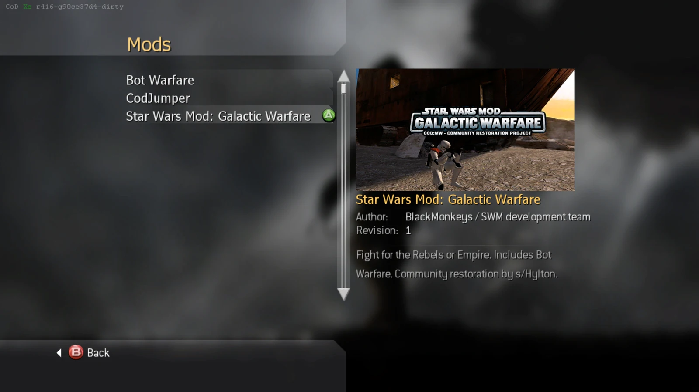
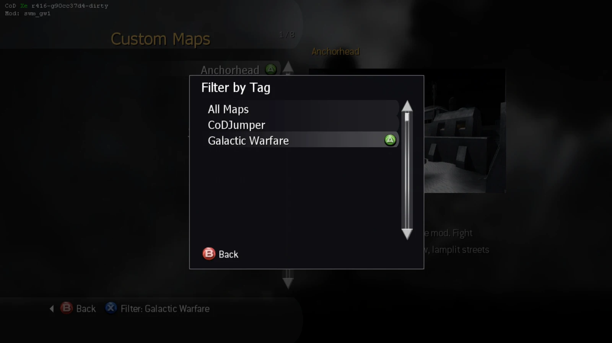

import { Image } from "astro:assets";
import banner from "../../../../assets/iw3_galactic_warfare/galactic-warfare-banner.jpg";
import CatalogDownloads from "../../../../components/CatalogDownloads.astro";
import MapIssueLink from "../../../../components/MapIssueLink.astro";

<Image
  src={banner}
  alt="Galactic Warfare Community Restoration Project artwork"
  width={960}
  layout="constrained"
  priority
/>

Play as the Rebels or the Empire in Call of Duty 4 multiplayer. The Xbox 360 and Xenia port bundles Galactic Warfare, Bot Warfare, and eight maps in one ZIP.

<CatalogDownloads game="iw3" modId="star-wars-galactic-warfare" server:defer>
  
Loading the Galactic Warfare download…

</CatalogDownloads>

## Install

Install Call of Duty 4 **TU4** and [CoD Xe](/setup/). Close the game before copying the files.

1. Extract the ZIP into your [Call of Duty 4 content folder](/setup/#game-content-folders). It contains `mods/swm_gw1/` and eight folders under `usermaps/`.
2. If you already play Galactic Warfare, keep your existing `mods/swm_gw1/scriptdata/` files when prompted. That folder holds editable bot names and waypoints.
3. Start multiplayer, open **Mods**, and select **Star Wars Mod: Galactic Warfare**.

   

4. Open **Custom Maps** and press **X** to open **Filter by Tag**. Select **Galactic Warfare**, then choose a map.

   

## Included maps

<ul>
  {[
    "Anchorhead",
    "Bestine",
    "Bespin",
    "Jundland",
    "Jundland Dusk",
    "Mos Eisley",
    "Not a Cave",
    "Easybeat’s Rebellion",
  ].map((name) => (
    <li>
      {name}
      {" · "}
      <MapIssueLink
        game="Call of Duty 4"
        name={name}
        bundle="Star Wars: Galactic Warfare"
      />
    </li>
  ))}
</ul>

**Not a Cave** supports Deathmatch only and lacks bot waypoints.

## Credits

- [Original Galactic Warfare mod by blackMonkeys](https://www.moddb.com/mods/star-wars-mod-galactic-warfare)
- [Community Restoration Project by s/Hylton](https://www.moddb.com/mods/star-wars-mod-galactic-warfare-community-restoration-project/downloads/star-wars-mod-galactic-warfare-community-restoration-project)
