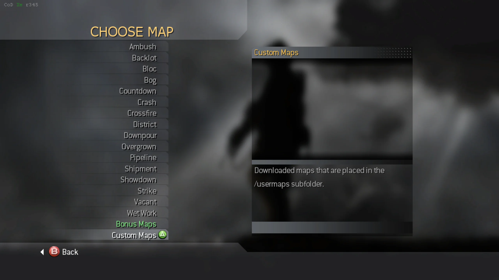
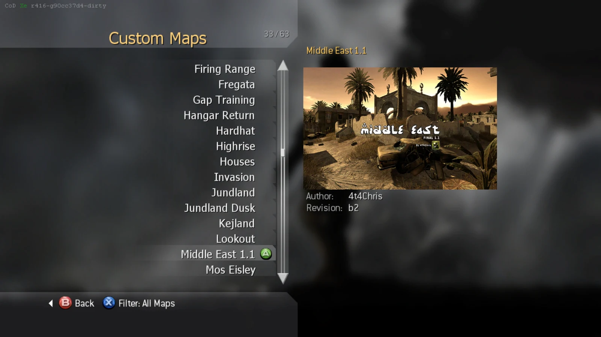

import CatalogDownloads from "../../../../components/CatalogDownloads.astro";

Choose a multiplayer map to download its ZIP for Xbox 360 or Xenia. Install Call of Duty 4 **TU4** and the [current CoD Xe client](/getting-started/) before [installing a map](#install-a-map-manually).

<CatalogDownloads game="iw3" server:defer>
  
Loading map downloads…

</CatalogDownloads>

The eight Star Wars maps are bundled with [Galactic Warfare](/guides/iw3/galactic-warfare/).

## Install a map manually

Extract your map ZIP into the game content folder for your platform.

| Platform | Game content folder                                                   |
| -------- | --------------------------------------------------------------------- |
| Xbox 360 | `_codxe\games\iw3\` on the HDD or USB drive where CoD Xe is installed |
| Xenia    | `plugins\415607E6\_codxe\` in your Xenia storage directory            |

The ZIP includes `usermaps` and the map folder inside it. For example, Rust extracts to `usermaps/mp_mw2_rust/`. For a manual update, move the previous copy of that map folder aside before extracting the new ZIP.

## Use Custom Maps

CoD Xe reads the game’s `usermaps` folder when populating the map picker. The
**Custom Maps** list updates when map folders are added or removed.

1. When choosing a map for a System Link or private match, select
   **Custom Maps**.

2. Select a map from the scrollable list.

## Next Step

Install [IW3 Bot Warfare](/guides/iw3/bot-warfare/) to add bots to Call of Duty
4 multiplayer.
