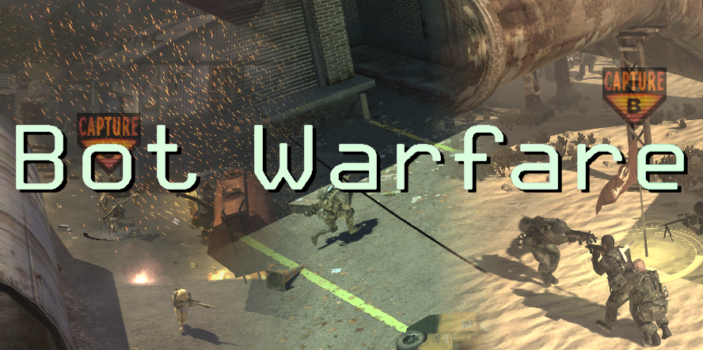
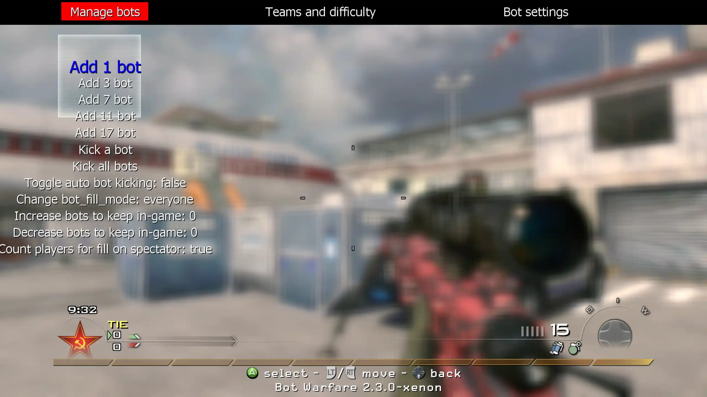

import { Badge, LinkButton } from "@astrojs/starlight/components";

Bot Warfare adds AI opponents to Modern Warfare 2 multiplayer. You’ll need the USA / Europe release with **TU6** and [CoD Xe](/setup/).

## Download and install

<LinkButton
  href="https://github.com/codxenon/iw4-bot-warfare-xenon/releases/download/v2.4.0-xenon/iw4bw-2.4.0-xenon.zip"
  icon="download"
>
  Download Bot Warfare ZIP
</LinkButton>

Open `_codxe/mods/` inside the ZIP. Copy the complete `bot_warfare` folder into `mods/` in your [Modern Warfare 2 content folder](/setup/#game-content-folders).

## Load Bot Warfare

1. Launch Modern Warfare 2 multiplayer and open **Mods** from the main menu.
2. Select **Bot Warfare** (or `bot_warfare`) to load it.
3. Start a System Link or private match. Press <Badge text="D-Pad Down" /> to open the Bot Warfare menu. Use the movement controls to browse options and jump to select. Press <Badge text="D-Pad Down" /> again to close it.

Start with a few bots. If the match slows down, lower **Bot awareness quality** or reduce the bot count.

To rename bots, edit `mods/bot_warfare/scriptdata/botnames.txt` in your Modern Warfare 2 content folder. Put one name on each line.

## Unlock offline loadouts

From the multiplayer menu, enter `unlockstats` in the CoD Xe console. Check **Barracks** to confirm level 70, then use **Create a Class** to customise your offline loadouts.

Original mod by [INeedGames](https://github.com/ineedbots/iw4_bot_warfare). [Modern Warfare 2 Xenon port source](https://github.com/codxenon/iw4-bot-warfare-xenon).
