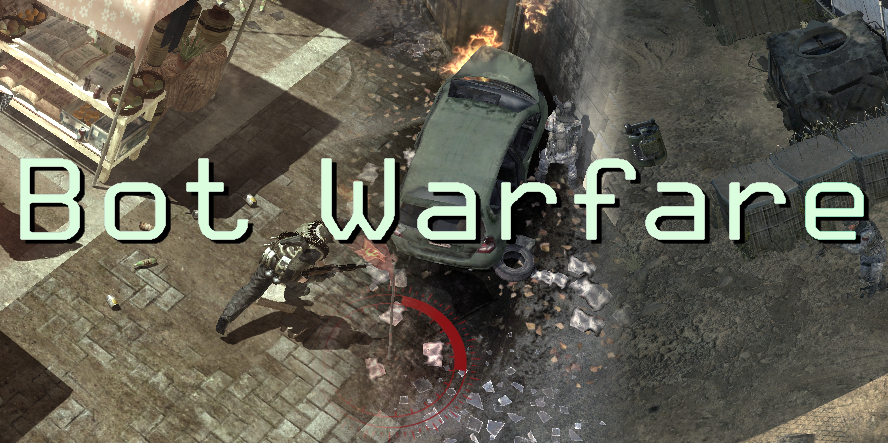
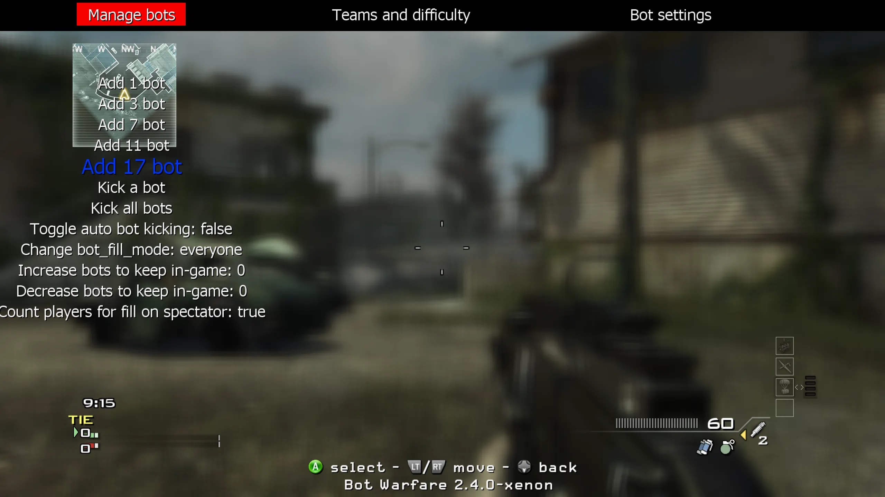

import { Badge, LinkButton } from "@astrojs/starlight/components";

Bot Warfare adds AI opponents to Modern Warfare 3 multiplayer. You’ll need the USA / Europe release with **TU24** and the [current CoD Xe client](/setup/).

## Download and install

<LinkButton
  href="https://github.com/codxenon/iw5-bot-warfare-xenon/releases/download/v2.4.1-xenon/iw5bw-2.4.1-xenon.zip"
  icon="download"
>
  Download Bot Warfare ZIP
</LinkButton>

1. Open `_codxe/mods/` inside the ZIP. Copy the `bot_warfare` folder into `mods/` in your [Modern Warfare 3 content folder](/setup/#game-content-folders).
2. Copy `codxe.json` from the ZIP’s `_codxe/` folder into that content folder, beside `mods/`. If you already have a `codxe.json` there, set `"active_mod": "bot_warfare"` in it.

## Play with bots

1. Launch Modern Warfare 3 multiplayer and look for `Mod: bot_warfare`.
2. Start a System Link or private match. Press <Badge text="D-Pad Down" /> to open the Bot Warfare menu and add bots.

System Link saves multiplayer progression, so you can level up and build custom classes offline.

Start with a few bots. If the match slows down, lower **Bot awareness quality** or reduce the bot count.

To rename bots, edit `mods/bot_warfare/scriptdata/botnames.txt` in your Modern Warfare 3 content folder. Put one name on each line.

Original mod by [INeedGames](https://github.com/ineedbots/iw5_bot_warfare). [Modern Warfare 3 Xenon port source](https://github.com/codxenon/iw5-bot-warfare-xenon).
