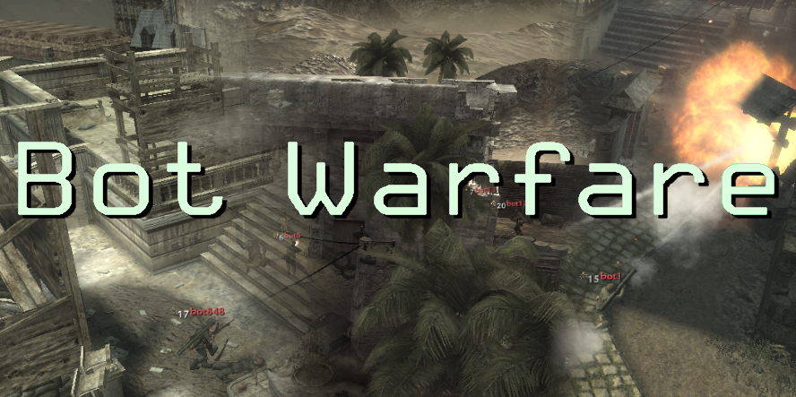
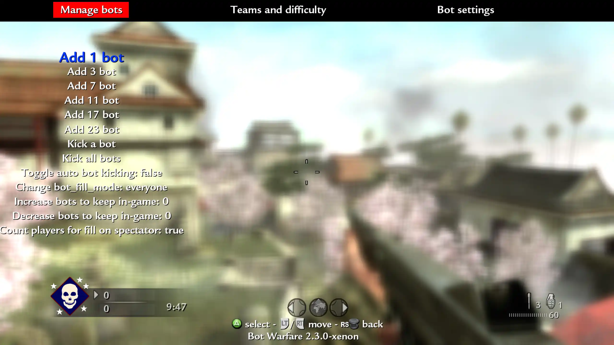

import { Badge, LinkButton } from "@astrojs/starlight/components";

Bot Warfare adds AI opponents to World at War multiplayer. You’ll need the USA / Europe release with **TU7** and the [current CoD Xe client](/setup/).

## Download and install

<LinkButton
  href="https://github.com/codxenon/t4-bot-warfare-xenon/releases/download/v2.4.0-xenon/t4bw-2.4.0-xenon.zip"
  icon="download"
>
  Download Bot Warfare ZIP
</LinkButton>

Open `_codxe/mods/` inside the ZIP. Copy the complete `bot_warfare` folder into `mods/` in your [World at War content folder](/setup/#game-content-folders).

## Load Bot Warfare

1. Launch World at War multiplayer and open **Mods** from the main menu.
2. Select **Bot Warfare** (or `bot_warfare`) to load it.
3. Start a System Link or private match. Press <Badge text="X" /> + <Badge text="RS" /> to open the Bot Warfare menu.

Use **Bot awareness quality** and the bot count to tune performance. Start with a few bots and add more as your match allows.

To rename bots, edit `mods/bot_warfare/scriptdata/botnames.txt` in your World at War content folder, with one name per line.

Original mod by [INeedGames](https://ineedbots.github.io). [World at War Xenon port source](https://github.com/codxenon/t4-bot-warfare-xenon).
