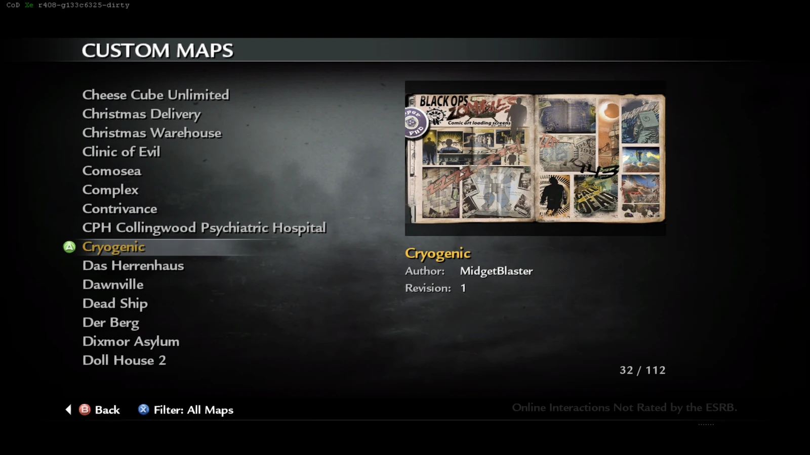

import CatalogDownloads from "../../../../components/CatalogDownloads.astro";

These are Zombies maps curated for Xbox 360 and Xenia. You’ll need a USA / Europe copy of World at War with **TU7** and the [current CoD Xe client](/setup/).

[Jump to map downloads](#available-maps)

## Install a map

Extract the ZIP into the [World at War content folder](/setup/#game-content-folders). The ZIP supplies `usermaps` and the map folder inside it.

When updating manually, move the previous copy of that map out of `usermaps` before extracting the new version.

## Use Custom Maps

Launch World at War and open **Custom Maps** from the Zombies map selector. Choose the map you installed.

Show the Custom Maps browser

## Available maps

<CatalogDownloads game="t4" mapMode="zombies" server:defer>
  
Loading map downloads…

</CatalogDownloads>
