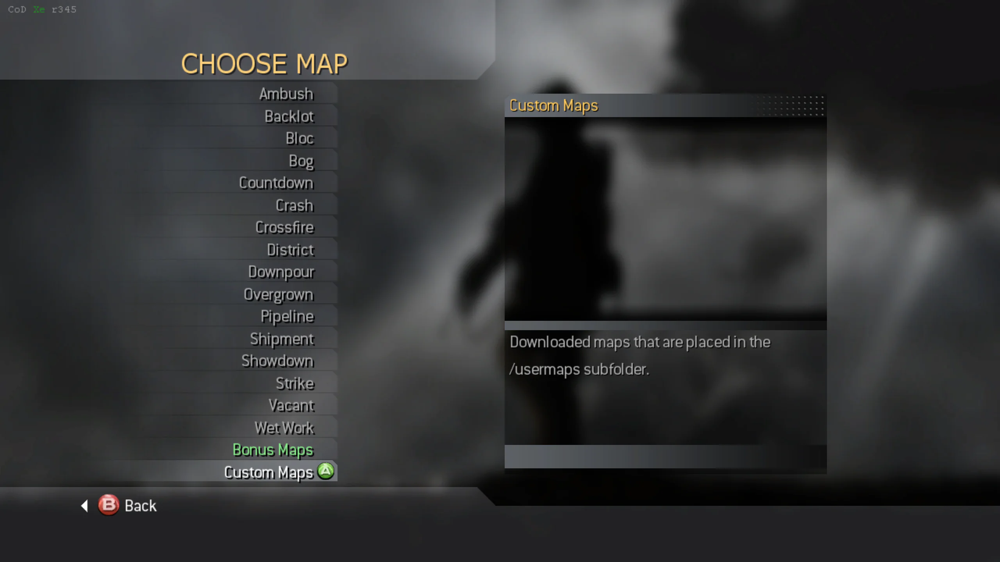
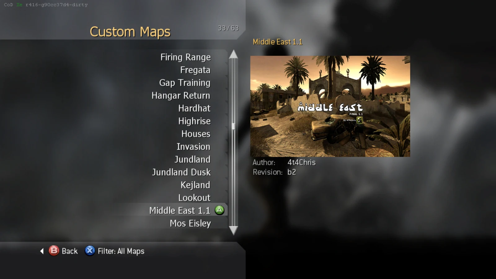

import { CardGrid, LinkCard } from "@astrojs/starlight/components";
import MapCatalog from "../../../../components/MapCatalog.astro";

Choose a Call of Duty 4 multiplayer map below. Each ZIP works on Xbox 360 and Xenia.

## What You Need

- A **genuine USA / Europe copy** of Call of Duty 4: Modern Warfare
- Call of Duty 4 **TU4**
- **CoD Xe client r415 or later** to play audio from map `.pak` files.

Install CoD Xe before continuing:

<CardGrid>
  <LinkCard
    title="Xbox 360"
    href="/guides/codxe/xbox-360/"
    description="Install CoD Xe on an Xbox 360."
  />
  <LinkCard
    title="Xenia"
    href="/guides/codxe/xenia/"
    description="Install CoD Xe on Xenia Canary."
  />
</CardGrid>

## Available maps

<MapCatalog game="iw3" server:defer>
  
Loading map downloads…

</MapCatalog>

## Install a map manually

The CoD Xe client includes the required IW3 fastfiles. Extract your map ZIP into the game content folder for your platform.

| Platform | Game content folder |
| --- | --- |
| Xbox 360 | `_codxe\games\iw3\` on the HDD or USB drive where CoD Xe is installed |
| Xenia | `plugins\415607E6\_codxe\` in your Xenia storage directory |

The ZIP includes `usermaps` and the map folder inside it. For example, Rust extracts to `usermaps/mp_mw2_rust/`. For a manual update, move the previous copy of that map folder aside before extracting the new ZIP.

## Use Custom Maps

CoD Xe reads the game’s `usermaps` folder when populating the map picker. The
**Custom Maps** list updates when map folders are added or removed.

1. When choosing a map for a System Link or private match, select
   **Custom Maps**.

2. Select a map from the scrollable list.

## Next Step

Install [IW3 Bot Warfare](/guides/iw3/bot-warfare/) to add bots to Call of Duty
4 multiplayer.
