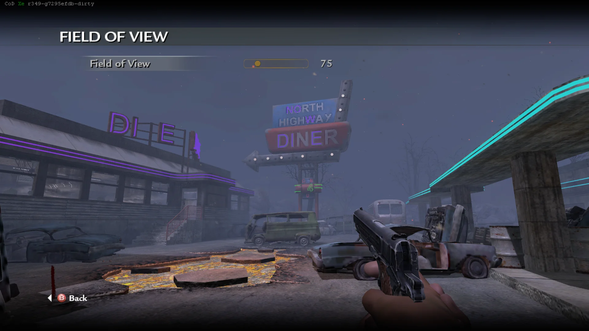
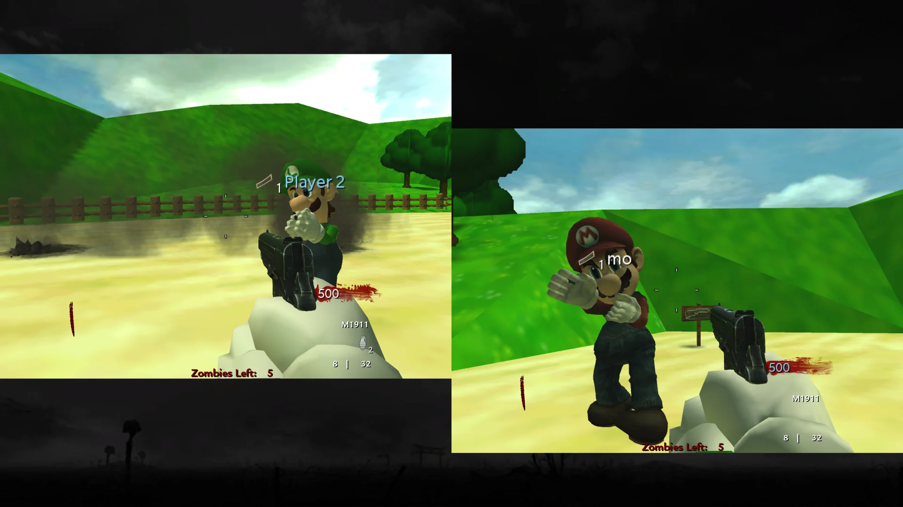

import { CardGrid, LinkCard } from "@astrojs/starlight/components";
import CatalogDownloads from "../../../../components/CatalogDownloads.astro";

Choose a World at War map below. Each ZIP works on Xbox 360 and Xenia.

## Available maps

<CatalogDownloads game="t4" server:defer>
  
Loading map downloads…

</CatalogDownloads>

## Install a map manually

Extract the ZIP into the game content folder below. The archive supplies `usermaps` and the map folder inside it.

| Platform | Game content folder                                                  |
| -------- | -------------------------------------------------------------------- |
| Xbox 360 | `_codxe\games\t4\` on the HDD or USB drive where CoD Xe is installed |
| Xenia    | `plugins\4156081C\_codxe\` in your Xenia storage directory           |

When updating manually, move the previous copy of that map out of `usermaps` before extracting the new version.

## What You Need

- A **genuine USA / Europe copy** of Call of Duty: World at War
- Call of Duty: World at War **TU7**
- The latest **CoD Xe** plugin

Prepare a clean game folder and install CoD Xe before continuing:

<CardGrid>
  <LinkCard
    title="Prepare game files"
    href="/guides/prepare-game-files/"
    description="Use clean, unmodified game files."
  />
  <LinkCard
    title="Install World at War TU7"
    href="/reference/supported-games/"
    description="Download TU7 and install it for your platform."
  />
  <LinkCard
    title="Xbox 360"
    href="/guides/codxe/xbox-360/"
    description="Install CoD Xe on an Xbox 360."
  />
  <LinkCard
    title="Xenia"
    href="/guides/codxe/xenia/"
    description="Install CoD Xe on Xenia Canary."
  />
</CardGrid>

## Known Issues

- Missing sounds
- Low quality textures
- Pack-a-Punch on certain weapons on certain maps can crash the game

## Field of View

Open **Start** > **Options**, then select **Field of View** to adjust the
slider.

## Split Screen

Split Screen support varies by map.

