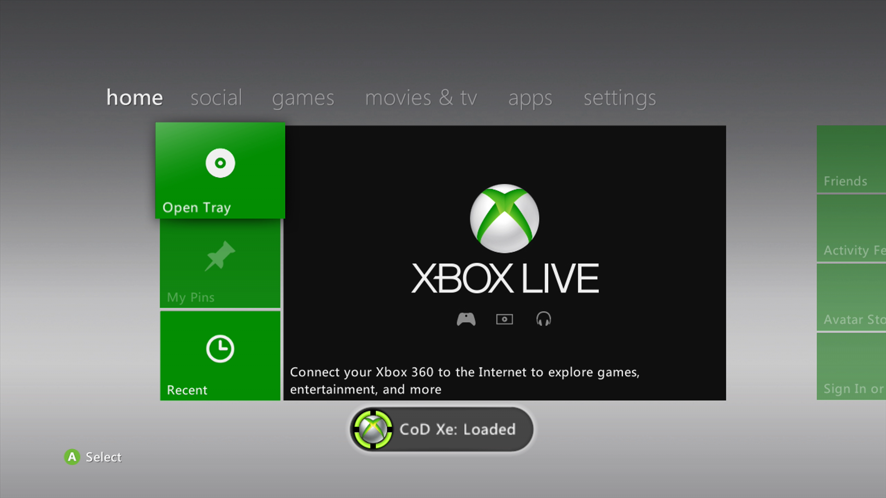

import CatalogDownloads from "../../../../components/CatalogDownloads.astro";

You’ll need an Xbox 360 that can load unsigned plugins and a copy of a [supported game](/help/compatibility/). Launch your game from disc, Games on Demand (GOD), or an extracted folder as usual.

## Download CoD Xe

<CatalogDownloads platform="xbox360" server:defer>
  
Loading the Xbox 360 client…

</CatalogDownloads>

## Set up the plugin

1. Extract the client ZIP on your computer. The entire `_codxe` folder must go at the **root of the Xbox 360 storage device** you’re using. On `Hdd1:`, the plugin path is `Hdd1:\_codxe\codxe.xex`.
2. In DashLaunch, set a plugin slot to your copied `codxe.xex` and save the configuration. If you use another module loader, configure it to load `codxe.xex` at the dashboard.
3. Find your game’s [required title update](/help/compatibility/) in the ZIP’s `title-updates` folder. Follow the [Xbox 360 title update guide](/help/xbox-360-title-updates/) to copy it to the right location.
4. Restart the console. Look for **CoD Xe: Loaded** on the dashboard, then launch your game.

   

Update or move an existing install

Disable older CoD Xe loader entries before rebooting. Merge the new client files and bundled zones into your installation. Keep your settings, stats, maps and mods. If these files used to live in a `_codxe` folder beside the game, move that game’s data into `_codxe\games\<game>\` in the new installation.

## Install maps and mods

Find your [game’s content folder](/setup/#game-content-folders), then follow the map or mod’s install instructions.

[Browse the maps and mods library](/games/) · [Get setup help](/help/)
